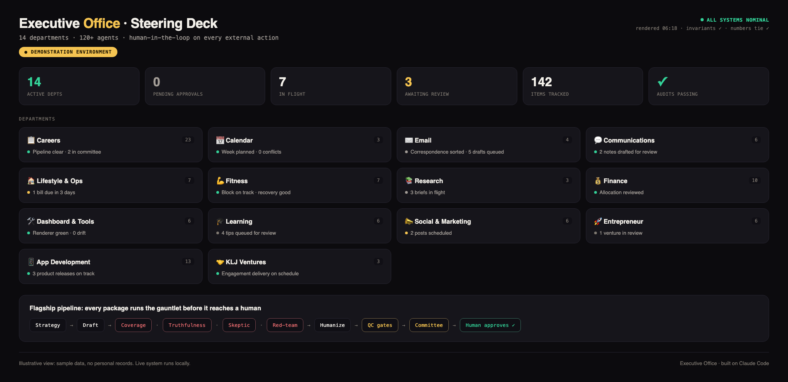
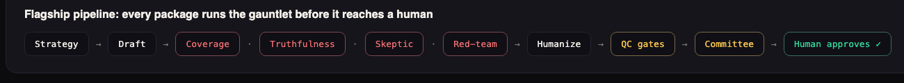
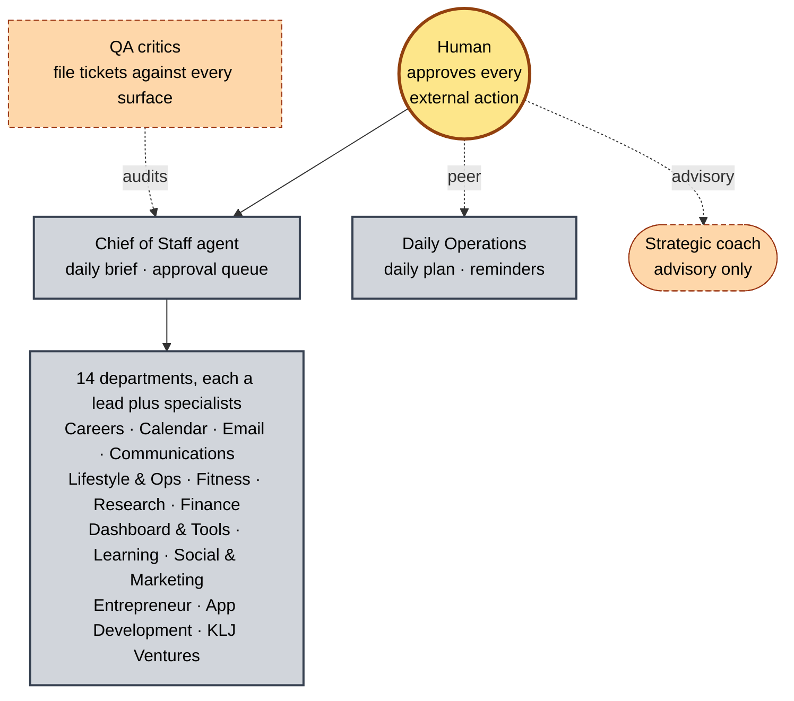

# Executive Office: Human-Governed AI Workflows

Executive Office is the AI operating system I designed and run for my own work: a job search, a calendar, email, research and a few side ventures. Specialist agents prepare drafts, status reports and a daily brief. I review and approve everything that leaves the system.

I am a Strategy & Operations leader, and this is a portfolio piece about how I design workflows where AI does the preparation and a person owns the decision.

## What is public here

This repository is an **architecture showcase**, a set of **examples**, and one small **runnable demonstration** with synthetic data.

- **Public:** the design, the agent catalog, sanitized examples, a runnable demo, and this documentation.
- **Private:** my live data, the working agent configurations, the scripts that run the real system, and anything with personal or client information. None of it is committed here.

Because the running system is private, some claims here cannot be checked from this repository. [docs/EVIDENCE.md](./docs/EVIDENCE.md) says which ones, plainly.

## Start here

| If you are | Read this first |
|---|---|
| An executive or recruiter with two minutes | The rest of this page, then [the synthetic pipeline walk-through](./examples/pipeline-run-example.md) |
| A technical reviewer | [demo/](./demo) (runs in a second, no install), then [docs/EVIDENCE.md](./docs/EVIDENCE.md) |
| Interested in the design | [ARCHITECTURE.md](./ARCHITECTURE.md) and [docs/PATTERNS.md](./docs/PATTERNS.md) |

## What it looks like

The Steering Deck, one view across 14 departments. **All data shown is synthetic.** It is a demonstration view built from sample data, with no personal records. Source: [docs/source/steering-deck-demo.html](docs/source/steering-deck-demo.html).

Close-up of the same synthetic view: by design, each package passes four independent critics, a QC check and a committee before it reaches a person, and a person makes the final call.

## Three things it produces

- **A daily brief.** One read that covers every department: what changed, what is blocked, and what needs my decision today.
- **Decision-ready packages.** Work that has been drafted, then reviewed by separate agents whose only job is to find problems, before I see it.
- **Drafts staged for approval.** Outreach, replies and prep documents wait in a queue for my approval.

## One request, end to end

A concrete case, using the [synthetic pipeline example](./examples/pipeline-run-example.md):

1. A job description arrives. A strategy agent writes a short positioning brief.
2. Drafting agents write a résumé and cover letter.
3. Separate critic agents check coverage, truthfulness, first impression and worst-case reading. A claim that would not survive an interview question is sent back.
4. A QC step checks the files, and a committee agent makes a final call.
5. The package lands in my review queue. I read it and decide whether to submit. I submit; the system prepares.

The example is a **synthetic illustration**: the company, numbers and dialogue are invented. It shows the shape of the workflow, not a real trace.

## What I designed, and what AI built

I designed the operating model: the departments, who reviews whose work, which actions need approval, and the standing rules the system follows. I run it day to day and decide what ships.

The implementation (agent definitions, Python scripts, dashboards, documentation) was built with Claude Code as my AI development partner, under my direction and review. The commit history reflects that co-authorship.

## Architecture at a glance

Work is organized the way a company is: a chief of staff agent coordinates 14 departments, each with a lead and specialists, and a QA team audits every surface. The design separates four jobs: setting direction, producing work, recording what happened, and putting decisions in front of a person. The department-by-department map and the diagrams for each part of the design are in [ARCHITECTURE.md](./ARCHITECTURE.md).

The substrate is Claude Code: sub-agents, hooks, scheduled tasks, MCP integrations, slash commands and file-based memory.

## Evidence and limitations

**What this repository shows:** the design, a catalog of roles, sanitized examples, and a small runnable demo of two ideas (a brief that refuses inconsistent numbers, and an approval gate that blocks external actions).

**Scope of the evidence:** the repository demonstrates two ideas on synthetic data and describes the rest. How the private hooks are implemented, and any operating metrics, are held privately.

The demo is a separate, simplified implementation of the pattern. It is not the private code.

### Inventory (counted 2026-11-09)

These are counts of what exists, not measures of quality or impact.

| Measure | Value | Basis |
|---|---|---|
| Departments | 14 | [Agent catalog](./docs/AGENT-CATALOG.md) |
| Named agents | 120+ | Catalog totals; the arithmetic is checked in [EVIDENCE.md](./docs/EVIDENCE.md) |
| Slash commands | 48 | Counted on my machine; private |
| Scheduled-task definitions | 98, of which 19 are marked retired or disabled | Counted on my machine; private |
| Saved sessions | 307 | Session transcripts on my machine; private |

| Other kinds of evidence | Status |
|---|---|
| Quality evaluation | One historical back-test of a scoring model, described in [the lessons](./docs/OPERATING-NOTES.md#lessons-from-the-operating-record) with its method limits. |

## Documentation

| Document | What is inside |
|---|---|
| [demo/](./demo) | Runnable synthetic demo with tests |
| [docs/EVIDENCE.md](./docs/EVIDENCE.md) | Claim-to-evidence inventory |
| [ARCHITECTURE.md](./ARCHITECTURE.md) | Orchestration, the review pipeline, the approval-gate model, state, QA, model routing |
| [docs/AGENT-CATALOG.md](./docs/AGENT-CATALOG.md) | The roster across 14 departments, each agent with its job |
| [docs/PIPELINE.md](./docs/PIPELINE.md) | The multi-gate work pipeline, stage by stage |
| [docs/PATTERNS.md](./docs/PATTERNS.md) | Six engineering patterns and the failures behind them |
| [docs/OPERATING-NOTES.md](./docs/OPERATING-NOTES.md) | My operating philosophy, governance habits and lessons learned |
| [examples/](./examples) | Seven labeled examples (each states whether it is a template, pseudocode or synthetic) |
| [CHANGELOG.md](./CHANGELOG.md) | What changed here and when |

---
Designed and run by Kyle Littlejohn. Applied-AI orchestration and workflow automation.
